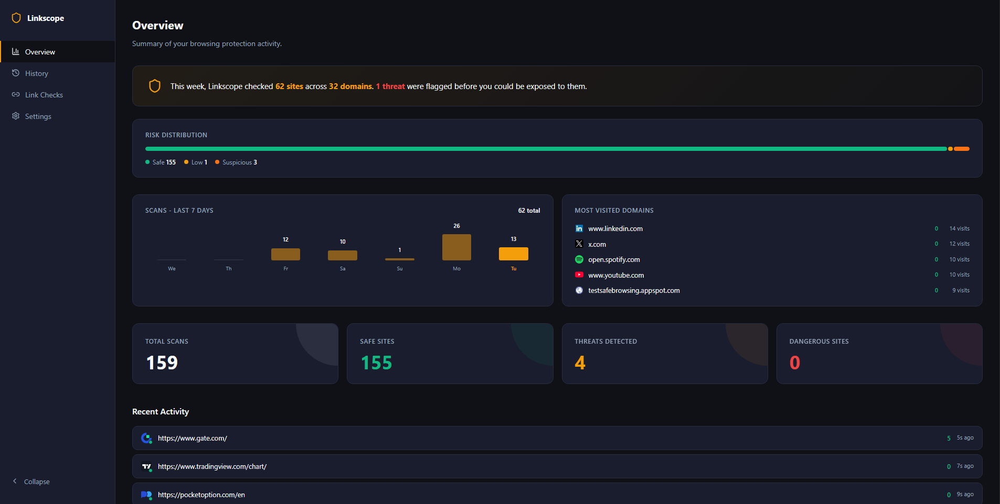
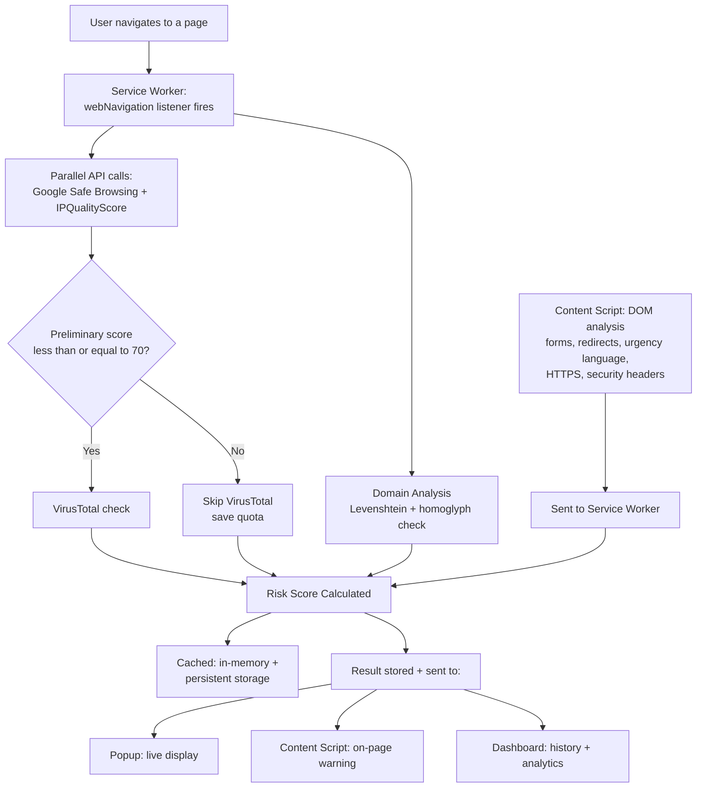

# Linkscope

Browser extension that inspects every site you visit against multiple threat intelligence sources and a custom domain analysis engine, then warns you before you interact with anything dangerous.



## Overview

Linkscope analyzes every page in real time as you browse. It cross-references each URL against three independent threat databases, then runs its own algorithmic checks for typosquatting, homograph attacks, and suspicious page behavior. Everything is cached locally to stay fast and stay within free API limits, and a full dashboard gives you visibility into your scan history and lets you tune how the extension behaves.

This project was built as a deep, hands-on exploration of browser extension architecture under Manifest V3, real-time threat intelligence integration, and practical detection algorithms, rather than as a production-ready public release. It's a portfolio piece demonstrating the full lifecycle of designing, building, and iterating on a non-trivial security tool.

## Key Features

**Detection**
- Multi-API threat intelligence (Google Safe Browsing, IPQualityScore, VirusTotal)
- Custom domain analysis: typosquatting detection via Levenshtein distance, homoglyph normalization, Punycode/IDN homograph detection
- Real-time DOM analysis: suspicious credential forms, redirect chain tracking, urgency-language detection
- Security header inspection (CSP, HSTS, X-Frame-Options, X-Content-Type-Options)
- Graduated warning system with three severity levels, shown directly on the page

**Dashboard**
- Overview with 7-day activity trend, risk distribution, and most-visited domains
- Full scan history with search, filtering, and CSV export
- Per-scan detail view with plain-language explanations for every flag
- Downloadable PDF scan reports
- Configurable risk thresholds, notification preferences, and whitelist management

**Architecture**
- Persistent caching with 24-hour TTL, surviving service worker restarts
- Right-click context menu to check any link without navigating to it
- Guided onboarding flow for first-time setup
- All API keys stored locally; nothing leaves the browser except direct calls to each service

## Architecture

Linkscope is built on Manifest V3 and runs across four distinct execution contexts that communicate through message passing and shared storage.



**Service Worker** (`src/background/`)
The persistent background process that orchestrates everything. Listens for navigation events via `webNavigation`, tracks redirect chains, observes security headers via `webRequest`, runs the full analysis pipeline, manages caching, and handles messaging between the popup, dashboard, and content script.

**Content Script** (`src/content/`)
Injected into every page. Runs DOM-level analysis (suspicious credential forms, urgency language, HTTPS check) and renders the on-page warning banners. Communicates findings back to the service worker via `chrome.runtime.sendMessage`, since content scripts cannot access most extension APIs directly.

**Popup** (`src/popup/`)
The toolbar UI showing the current tab's risk assessment in real time, with rescan, whitelist, and toggle controls.

**Dashboard** (`src/dashboard/`)
A full-page React app for reviewing scan history, configuring detection sensitivity, managing API keys, and exporting reports.

### Why this separation exists

Manifest V3 imposes hard boundaries between these contexts. Service workers are non-persistent and can be terminated at any time, so caching had to be designed to survive restarts. Content scripts run in an isolated world and cannot directly call most Chrome APIs, requiring all communication to happen through message passing. These constraints shaped most of the architectural decisions in this project, not as obstacles but as the actual design space being worked within.

## Detection Pipeline

### Domain Analysis

Every URL is checked against a list of commonly-spoofed brand domains using two techniques in sequence:

**Homoglyph normalization.** Before any comparison happens, the domain is normalized through a substitution table that maps visually deceptive characters to their standard equivalents, numbers that resemble letters (`0` to `o`, `1` to `l`), and Cyrillic characters that are visually identical to Latin ones but are different Unicode code points (`а` to `a`). Punycode-encoded domains (`xn--...`, how browsers represent internationalized domain names) are flagged directly as a mixed-script signal, since the raw Cyrillic characters are never visible to the extension in the first place.

**Levenshtein distance.** The normalized domain is compared against a list of frequently-impersonated brands using edit distance, the minimum number of single-character insertions, deletions, or substitutions needed to transform one string into another. A distance of 1 or 2 from a known brand (e.g. `paypa1.com` is distance 1 from `paypal`) flags the domain as a likely typosquatting attempt. The distance is calculated using a standard dynamic programming approach with a 2D grid built bottom-up, with O(n×m) time complexity.

### Multi-Source Threat Intelligence

Three independent APIs are queried for each unique domain:

- **Google Safe Browsing** checks against Google's database of confirmed malicious URLs
- **IPQualityScore** evaluates domain age, hosting reputation, and fraud signals
- **VirusTotal** aggregates results from 70+ independent antivirus engines

Google Safe Browsing and IPQualityScore are queried in parallel. VirusTotal is only queried if the preliminary score (calculated from the first two sources) is 70 or below, since a domain already flagged as dangerous doesn't need a third confirmation, and this conserves VirusTotal's stricter rate limits.

### Risk Scoring

Each signal contributes a weighted point value to a 0-100 score:

| Signal | Points | Source |
|---|---|---|
| Google Safe Browsing match | 80 | API |
| IPQualityScore phishing/malware flag | 60 | API |
| VirusTotal detection (5+ engines) | 50 | API |
| Domain lookalike (typosquatting) | 40 | Domain analysis |
| Mixed-script / homograph domain | 40 | Domain analysis |
| Suspicious credential form | 30 | DOM analysis |
| Suspicious redirect chain | 25 | Navigation tracking |
| Missing HTTPS | 20 | Content script |
| Missing security headers (CSP/HSTS) | up to 10 | Service worker |
| Urgency language detected | 15 | DOM analysis |

Scores are capped at 100. The resulting score maps to one of four risk levels (Safe, Low, Suspicious, Dangerous), with thresholds that are user-configurable in Settings rather than fixed.

### Caching Strategy

API calls are cached at two layers to minimize redundant requests within free-tier rate limits:

1. **In-memory cache** (`Map`), fast, but cleared whenever the service worker restarts
2. **Persistent cache** (`chrome.storage.local`), survives restarts, with a 24-hour TTL per domain

A domain visited multiple times within 24 hours triggers zero additional API calls after the first lookup. An in-flight request tracker (`pendingAnalyses`) also prevents duplicate concurrent API calls when a navigation event and the content script's analysis request both arrive for the same URL within milliseconds of each other, a race condition that was identified and fixed during development.


### Testing Approach

Detection accuracy was validated using known-safe test patterns (the EICAR test file convention for VirusTotal, Google's published Safe Browsing test URLs) and manually constructed scenarios (multi-hop redirect chains built with real URL shorteners, deliberately malformed domains for typosquatting checks) rather than live phishing sites. Verified phishing URLs are ephemeral by design, they're typically taken down within hours of detection, which makes them unsuitable for a stable, repeatable test process. This is a real constraint of testing in this problem domain rather than a gap in effort.


## Tech Stack

**Build tooling**
- [Vite](https://vitejs.dev/) with [CRXJS](https://crxjs.dev/) for Manifest V3 bundling and hot reload
- React 18 for the popup and dashboard UIs
- Tailwind CSS for utility styling

**APIs**
- [Google Safe Browsing API v4](https://developers.google.com/safe-browsing)
- [IPQualityScore](https://www.ipqualityscore.com/)
- [VirusTotal API v3](https://www.virustotal.com/)

**Chrome Extension APIs used**
`webNavigation`, `webRequest`, `tabs`, `storage`, `notifications`, `contextMenus`

## Installation

1. Clone the repository:
   ```bash
   git clone https://github.com/Yessineee/linkscope.git
   cd linkscope
   ```

2. Install dependencies:
   ```bash
   npm install
   ```

3. Build the extension:
   ```bash
   npm run build
   ```

4. Load it in your browser:
   - Open `chrome://extensions` (or `brave://extensions`)
   - Enable **Developer mode**
   - Click **Load unpacked** and select the `dist/` folder

5. Open the dashboard (click the toolbar icon → **Open Dashboard**) and complete the onboarding flow, or go to **Settings** to add your own free API keys:
   - [Google Safe Browsing](https://console.cloud.google.com)
   - [IPQualityScore](https://www.ipqualityscore.com/create-account)
   - [VirusTotal](https://www.virustotal.com/gui/join-us)

## Design Decisions & Tradeoffs

Every non-trivial project involves scope and engineering tradeoffs. These were made deliberately, and the reasoning is documented here rather than hidden.

**TLD extraction uses a curated list, not the full Public Suffix List.**
`extractDomain` correctly handles common multi-part TLDs (`.co.uk`, `.com.au`, etc.) via a curated list of roughly 30 entries, rather than pulling in the full Public Suffix List, which contains thousands of entries and would add meaningful bundle size for a browser extension. This covers the overwhelming majority of real-world domains; a small number of obscure multi-part TLDs outside the curated list would be parsed slightly incorrectly.

**Redirect chain tracking is heuristic, not exhaustive.**
Manifest V3 restricts `webRequest` to non-blocking, observational use for most extensions, full request interception (`webRequestBlocking`) is reserved for enterprise-managed extensions. Redirect chains are reconstructed from `webNavigation` events (`onBeforeNavigate`, `onCommitted`), then filtered against two shared allowlists before being flagged: a list of roughly 110 well-known global domains (the same list used for lookalike detection) and a small set of known URL shortening/redirect services (`t.co`, `bit.ly`, etc.), kept separate since they serve a genuinely different purpose than brand-recognition. This is reliable for the common case but does not capture every possible redirect pattern a `webRequestBlocking`-enabled extension could see. During development, this approach required several fixes: filtering non-HTTP(S) URLs (browser internal pages like `chrome://newtab` were briefly being counted as redirect hops), resetting the tracked chain at the start of each new top-level navigation (to prevent unrelated navigations within the same tab from being treated as one continuous redirect chain), and later expanding the initial 11-domain trust list to the full shared allowlist after discovering it was too narrow to reliably avoid false positives on common OAuth and payment redirect flows.

**API calls are not cancelled mid-flight when the extension is disabled.**
Toggling the extension off during an in-progress scan does not abort the underlying network requests already sent to GSB/IPQS/VT, it prevents the result from being surfaced (no warning, no notification, no stored result), but the API calls themselves complete in the background. Implementing true request cancellation would require restructuring the fetch logic around `AbortController` across all three API clients for a behavior that has no visible user impact, since results are suppressed either way.

**Free-tier hosting platforms can trigger false positives.**
IPQualityScore's `risky_tld` heuristic flags domains on platforms like Vercel, Netlify, and GitHub Pages as higher-risk, because these platforms are disproportionately used for disposable phishing infrastructure (free, instant deployment, automatic HTTPS). This is a legitimate statistical signal on IPQS's part, not a bug, but it does mean legitimate personal projects and portfolios hosted on these platforms can score higher than their actual risk. Users can whitelist specific domains to resolve this on a per-site basis.

**Levenshtein-based lookalike detection has inherent false positives between similar legitimate brands.**
A distance threshold of 2 catches most typosquatting attempts (`paypa1.com` vs `paypal`) but can also flag legitimate brand pairs that happen to be naturally close in edit distance, for example, `spotify.com` is distance 2 from `shopify`. To address this, any domain in a curated allowlist of roughly 110 well-known global sites is excluded from lookalike checks entirely, since visiting a recognized top-traffic domain should never itself be treated as suspicious. This list is not exhaustive, an extremely rare collision involving a domain outside this list is still theoretically possible, but it covers the realistic collision space effectively and is shared with the redirect-trust logic to keep a single source of truth.

**Urgency-language detection requires multiple corroborating signals, not a single keyword match.**
Many individual phrases associated with phishing (`"verify your account"`, `"unusual activity detected"`, `"security alert"`) are also used by entirely legitimate banking, e-commerce, and security-notification pages. Flagging on any single match produced meaningful false-positive risk. The detector now requires at least two distinct pattern matches on the same page before flagging urgency language, since real phishing pages typically stack several manufactured-urgency phrases together, while legitimate pages rarely contain more than one in isolation.

**No machine learning-based content classification.**
Linkscope's content analysis (urgency language, suspicious forms) is rule-based and keyword-driven rather than ML-based. This was a deliberate scope decision: a useful phishing-classification model requires a large, well-labeled dataset of real phishing and legitimate page content, building and validating that dataset is a substantial project in its own right, separate from extension development. It's also worth noting that the three integrated APIs (GSB, IPQS, VT) are themselves ML-driven under the hood, so Linkscope already benefits from machine learning indirectly through API orchestration rather than reimplementing it from scratch with far less training data than any of those providers have access to. A future iteration could add this as an opt-in feature using an LLM API for content analysis on already-flagged pages, explicitly scoped to avoid sending every page's content externally by default, preserving the local-first privacy model.

## Future Improvements

- **ML-based content classification.** Train a lightweight model on a labeled phishing/legitimate page dataset for content analysis beyond keyword matching, or integrate an opt-in LLM-based analysis step for pages already flagged as suspicious.
- **Full Public Suffix List support** for complete multi-part TLD coverage.
- **`webRequestBlocking`-based redirect tracking** if migrated to an enterprise-managed deployment context, for complete redirect chain visibility.
- **Bundled or shared API keys** with backend-managed rate limiting, removing the per-user API key setup requirement, a prerequisite for any public/Web Store release.
- **Weekly email digest** summarizing protection activity, extending the in-dashboard protection summary to a recurring notification.
- **Browser-sync support** for settings and whitelist across devices via `chrome.storage.sync`.

## Project Structure

```
src/
├── background/        # Service worker: APIs, scoring, caching, orchestration
├── content/            # Content script: DOM analysis, warning banners
├── popup/              # Toolbar popup UI
├── dashboard/           # Full-page dashboard UI
└── utils/               # Shared URL/domain utilities
manifest.json
vite.config.js
```

## License

MIT

## Author

Built by [Yessine](https://github.com/Yessineee) as a portfolio project exploring browser extension architecture, real-time threat intelligence integration, and applied detection algorithms.